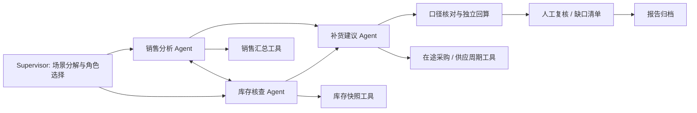

# 补货建议与库存检查：使用说明

假设你是邻里生活超市的采购负责人：咖啡快卖完了，马克杯积压，花茶库存账对不上。这里帮你查销售、核库存、考虑已订未到的货和供应商送货时间，最后列出建议采购数量，交给你确认。

**无需填写模型密钥也能使用。** 内置虚构业务数据，程序负责计算；填写深度求索模型密钥后，可增加智能文字解读。确认只保存建议，不自动下采购单。

页面没有项目品牌名称，按“选商品 → 看建议 → 你确认”的业务顺序使用。

分析过程中，右侧“每个角色做了什么”会分别展示分析安排、销售分析、库存核查、补货建议、交叉校验和人工确认六个角色。展开任一角色，可以看到它查询了哪类业务记录、是否因库存口径不一致重新查询、何时完成计算，以及为什么停在人工确认。历史任务重新打开时，也会从已保存的进度事件还原这些步骤。

## 最快启动（Windows）

需要 Python 3.11 或更新版本。双击 **`start.bat`**，首次启动自动创建虚拟环境、安装依赖、生成 `config.local.toml`。出现启动提示后，浏览器打开 <http://127.0.0.1:8000>。首次安装需联网；使用 `python` 命令，不依赖可能指向旧环境的 `py`。

未填写密钥即可完整演示，页面会明确标识“离线演示模式”。Linux / macOS 使用 `sh start.sh`。

## 配置 DeepSeek：每个人只改一个文件

编辑项目根目录 **`config.local.toml`**（首次启动会从 `config.example.toml` 自动复制），将自己的密钥填入：

```toml
[deepseek]
api_key = "sk-在这里填写自己的DeepSeek密钥"
base_url = "https://api.deepseek.com"
model = "deepseek-chat"
timeout_seconds = 25
```

保存后重启服务。API 调用代码集中在 `app/llm.py`；正常使用不需要修改 Python 文件。支持兼容 OpenAI Chat Completions 的地址和模型。网络、鉴权或结构化输出失败时会明确提示降级，不会阻断规则计算。密钥不下发浏览器、不写入报告、不打入镜像。

给不同人部署时，分别复制项目源码，各自配置 `config.local.toml`，分别生成自己的 `data` 目录。不要复制你的 `config.local.toml`、`.env`、`data/` 和 `.venv/`；它们包含个人配置、业务数据或机器相关环境。每次分析最多调用模型三次。

也可直接分发 `dist/补货分析演示源码.zip`。修改源码后运行 `python scripts/build_release.py` 重新打包；打包使用文件白名单，自动排除个人配置和运行数据。

如果对方只需要安装使用，可分发 `dist/补货建议安装包.zip`。解压后双击“安装并启动补货建议.bat”，它会创建本地虚拟环境、安装依赖并打开浏览器。这个安装包为了方便部署，省去了测试和开发说明，但 Python 文件仍随应用运行所需文件一起放在包内，具备开发能力的人仍然可以修改。需要完整二次开发时，请分发 `补货分析演示源码.zip`，其中包含全部应用代码、测试、构建脚本和架构说明；两份包都不包含你的 `config.local.toml`、`data/` 或模型密钥。

也可以设置 `DEEPSEEK_API_KEY`、`DEEPSEEK_BASE_URL`、`DEEPSEEK_MODEL` 环境变量，优先级高于配置文件。`RETAIL_CONFIG` 可指定其他配置文件。同一电脑的不同部署使用不同文件夹和端口：

```powershell
.\.venv\Scripts\python.exe -m uvicorn app.main:app --host 127.0.0.1 --port 8001 --workers 1
```

这是面向个人独立部署的演示版，没有登录鉴权。租户字段用于数据口径过滤，不是访问权限认证；不要直接暴露到公网。每个实例只运行一个 worker，任务状态和检查点依赖本地持久化目录。

## 跟着一个实际场景操作

你是采购负责人王芳，正在安排邻里生活超市下一周的采购。

1. 打开首页，选“日常补货”，商家选“邻里生活超市”，仓库选“上海中心仓”。保留三种商品和默认日期，点击“查看补货建议”。
2. 系统会查最近三十天的销售、截止日库存、已订未到货以及供应商送货规则。页面显示具体进度，结果在下方出现。
3. 先看三张建议卡，再根据需要展开“这个数量怎么算出来的？”或数字明细。

| 商品 | 发生了什么 | 你该怎么处理 |
| --- | --- | --- |
| 挂耳咖啡（十袋装） | 每天卖十盒，现货三十五盒，只够卖三天半，供应商需要十天送到 | 建议补一百六十八盒，并联系供应商加急或考虑调货，避免新货到前断货 |
| 陶瓷马克杯（经典白色款） | 每天卖一个，仓库有四百五十个，按历史速度可卖四百五十天 | 本次补货为零，先消化库存，可考虑调整陈列或促销 |
| 茉莉花茶礼盒（双罐礼盒装） | 业务系统记为九十二盒，按实物扣减算出八十盒，供应商送货资料也不完整 | 暂不给补货数字，先找仓管核账、找供应商补交期；本次可人工填零暂不采购并写明原因 |

咖啡的一百六十八盒这样算：每天十盒 ×（送货十天 + 备用七天 + 距下次盘点七天）= 目标库存二百四十盒。减去现货三十五盒和预计及时到货四十盒，还缺一百六十五盒。每箱十二盒，向上凑整得到一百六十八盒。这个量用于补足计划库存，不能保证到货前不缺货。

4. 在“最后由你决定：这次买多少？”中填写审核人“采购负责人王芳”。咖啡和杯子保留默认数量；花茶填零，原因写“库存账和送货时间未确认，本次暂不采购”。
5. 填写本次决定的说明，核实问题后勾选确认，点击“确认数量并保存建议”。如果整份建议暂不接受，也可以填写原因后点击“这次不通过，保存原因”。
6. 点击“下载中文报告”，直接用浏览器打开或打印。报告保留原始建议、实际确认数量、调整原因、计算依据和数据来源。左侧“已做过的分析”可以重新打开历史记录。
7. 想演示大促：切换“促销备货”，预计销量填平时的一点五倍，其他条件不变，咖啡建议变为二百八十八盒。该倍数应用于整个备货周期，是人工提供的假设。
8. 想专门查看积压：选“清理积压”，系统会优先检查库存，重点关注马克杯这类库存能卖很久的商品；它仍会给出其他所选商品的补货建议。

页面上的“还有什么想重点了解的”在未配置模型密钥时只记录问题，不理解自由文字。商品、日期、销量倍数等计算条件请直接在表单中选择。更换商家或仓库会使用另一组演示记录，结果可能不同。

演示数据首次启动生成，后续不覆盖。需要重新生成最新日期的数据时，先停止服务，备份并重命名 `data` 目录，再启动即可；如果使用 MySQL，需单独准备一个新的演示库。

## 工作流与职责



- Supervisor 用明确的场景规则安排职责和顺序，避免简单演示中不必要的规划模型调用。
- 销售 Agent 查询本期和前一个等长周期，Pandas 汇总销量、日均与增长率，再交给 DeepSeek 解读。
- 库存 Agent 查询截止日及之前的最新快照；异常时绕过缓存补查一次，不无限循环。
- 补货 Agent 补充在途采购和供应规则，程序计算建议；跨来源核验后汇总各 Agent 证据交给 DeepSeek 做定性解释。
- `Pydantic` 校验请求、结论、来源、建议与审核字段。模型解读不允许阿拉伯数字和常见中文数量表达，数值从程序计算表展示。
- LangGraph 使用真实的 SQLite 持久化检查点与 `interrupt` / `Command(resume=...)`。节点有超时、图有步骤上限、工具有调用上限。
- 运行中关闭服务的任务会标记“可恢复”；重新打开页面点击“继续上次未完成的分析”。审核暂停的任务重启后可直接审核。恢复复用已完成节点数据；源数据已更正或希望全部刷新时应新建分析任务。
- 内存结果缓存默认两分钟；配置 Redis 后优先使用 Redis，故障时回退有界内存缓存。缓存键包含租户、仓库、SKU 和完整查询参数。

## 统一口径

| 指标 | 计算 / 约束 |
| --- | --- |
| 本期销量 | 起止日期均包含，按自然日汇总；当前演示表保存非负销售数量，未接入退货、促销渠道和金额 |
| 对比期 | 本期之前相同长度的自然日；上期为零时增长率为空 |
| 日均销量 | 本期销量 / 本期自然日数 |
| 可售库存 | 实物 − 锁定 − 残次；ERP 报表可售字段只用于差异校验 |
| 库存覆盖天数 | 可售 / 日均；日均为零显示为空，不生成无穷大 |
| 有效在途 | 统计日已下单、状态 open、未收货、预计在统计日之后且供应周期内到达；逾期采购另报异常 |
| 目标库存 | 日均 × 活动系数 ×（供应周期 + 安全天数 + 复核周期）；非活动场景系数为 1 |
| 建议数量 | max(0, 目标 − 可售 − 有效在途)，向上取整到包装量的整数倍 |
| 缺失规则 | 销售/采购须有覆盖声明；没有覆盖声明不把无记录当作零；库存、供应规则、数据完整性等阻断项对应建议为空 |

历史统计依赖源数据提供正确的截止日状态；演示采购表只保留当前收货状态，真实 ERP 接入应提供采购状态历史快照后再用于任意历史日回放。当前种子数据支持默认截止日演示，库存快照日期不符会阻断建议。

## 数据接入与文件结构

```text
app/
  config.py          配置读取与环境变量覆盖
  llm.py             DeepSeek / LangChain 调用及降级
  schemas.py         Pydantic 结构
  database.py        业务表、演示数据、任务及归档存储
  tools.py           四种查询工具与缓存
  calculations.py    Pandas 计算与独立标量回算
  catalog.py         中文商家、仓库、商品名称集中维护
  presentation.py    通俗行动说明与中文报告导出
  workflow.py        LangGraph Supervisor / 三种 Agent / 人工暂停
  main.py            FastAPI、SSE、恢复、审核、下载
  static/            无构建依赖的中文演示页面
tests/               业务场景、隔离、审核、超时和恢复测试
data/                首次启动生成，勿提交或跨用户复制
config.local.toml    每个用户自己的配置，勿提交
```

`database.py` 定义 `sales`、`inventory`、`purchase_orders`、`suppliers`、`source_coverage` 五张业务表。真实 ERP 接入需适配这层数据或修改 `tools.py` 的查询映射；关闭 `seed_demo` 避免在空业务库中自动加入演示数据。

## Docker Compose（可选）

本机直接启动不需要 Docker。基础容器版使用 SQLite，不启动数据库服务：

```powershell
Copy-Item config.example.toml config.local.toml
# 编辑 config.local.toml 的 api_key
docker compose up -d --build app
```

完整演示使用 MySQL + Redis。首次运行先复制 `.env.example` 为 `.env`，默认密码仅用于本机演示；修改 MySQL 密码时也要同步修改 DATABASE_URL。容器间使用服务名连接，不向宿主机开放数据库端口：

```powershell
Copy-Item .env.example .env
docker compose --profile full up -d --wait mysql redis
docker compose --profile full up -d --build app
```

同机部署多份：每个人独立目录、独立 `config.local.toml`、独立数据；使用 `docker compose -p person_a ...` / `-p person_b ...` 区分容器与卷，并在各自 `.env` 中设置不同 `APP_PORT`。不要在基础 SQLite 演示中误复制完整栈 `.env`，否则应用会尝试连接 MySQL。

MySQL 保存业务数据；任务、审计事件、归档及 LangGraph 检查点仍放在挂载的 `data` 目录，符合轻量单进程演示定位。Compose 默认只绑定本机地址。

## API 与测试

交互 API 文档：<http://127.0.0.1:8000/docs>。

| 方法 | 路径 | 用途 |
| --- | --- | --- |
| POST | `/api/tasks` | 新建分析 |
| GET | `/api/tasks` | 最近任务 |
| GET | `/api/tasks/{id}` | 状态和报告 |
| GET | `/api/tasks/{id}/events` | SSE 进度，支持 Last-Event-ID 续传 |
| POST | `/api/tasks/{id}/resume` | 从失败/中断检查点恢复 |
| POST | `/api/tasks/{id}/review` | 人工通过/驳回和调整 |
| GET | `/api/tasks/{id}/report-readable` | 下载可阅读、可打印的中文报告 |
| GET | `/api/tasks/{id}/report` | 下载开发对接使用的结构化归档数据 |

```powershell
.\.venv\Scripts\python.exe -m pytest -q
```

测试默认不使用真实密钥、不消耗模型费用。首次依赖安装若网络失败，可手动更换可信 PyPI 镜像后重试。

可选页面冒烟测试：安装 `playwright` 后，保持服务运行，并执行 `python scripts/browser_smoke.py`。该脚本使用本机已安装的 Edge，验证分析、审核、刷新恢复和移动端宽度，并将截图写入 `data/`。普通用户运行平台不需要 Playwright。

本项目演示目标是完整展示“查数—核数—给建议—人工复核”的流程；不将背景中“报告缩短至三到四小时、返工低于百分之十”当作本项目已验证的性能结果。

开发说明：数据库和接口保留原有内部编号，避免旧记录失效；页面、进度、历史记录和中文报告统一显示实际业务名称。新增商品时在 app/catalog.py 维护名称、规格和计量单位。
